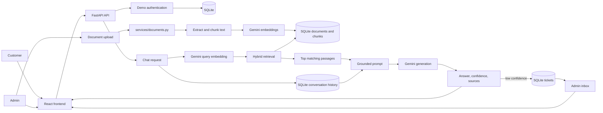

# AI Customer Support Agent

A portfolio project that answers customer-support questions from a private document set. The application indexes uploaded documents, retrieves relevant passages, asks Gemini to answer from those passages, shows the supporting sources, and creates a ticket when the system is not confident enough to answer.

## What it includes

- Upload and index `.txt`, `.md`, and text-based `.pdf` files
- Paragraph-aware chunking with overlap
- Gemini embeddings and local cosine-similarity retrieval
- Vector plus keyword retrieval for semantic questions and exact terms
- Answers with source excerpts
- Conversation history
- Confidence-gated human handoff and ticket creation
- Admin document management
- Agent inbox for escalated conversations
- Answer feedback collection
- Retrieval debugging and evaluation screens
- Demo authentication with customer and admin roles

## Architecture



There are two separate paths:

1. **Indexing:** upload → extract text → chunk → create embeddings → store chunks.
2. **Question answering:** question → create query embedding → retrieve passages → add conversation history → generate a grounded response.

## Repository layout

```text
backend/
  app/
    api/          FastAPI routes
    auth.py       Demo authentication and role checks
    config.py     Environment configuration
    database.py   SQLite schema and connections
    schemas.py    Request and response models
    main.py       Application entry point
services/
  documents.py   Text extraction, chunking, and indexing
  gemini.py      Gemini API client wrapper
  rag.py         Retrieval and grounded answer flow
  support.py     Tickets, feedback, and agent replies
frontend/
  src/            React application
knowledge_base/  Sample documents to upload
evaluation/
  questions.json Labeled retrieval questions
```

## Run locally

### Backend

From the repository root:

```powershell
cd backend
python -m venv .venv
.\.venv\Scripts\Activate.ps1
pip install -r requirements.txt
Copy-Item .env.example .env
```

Set the key in `backend/.env`:

```env
GEMINI_API_KEY=your_gemini_api_key
```

Start the API from the repository root:

```powershell
cd ..
uvicorn backend.app.main:app --reload --port 8000
```

The API is available at `http://localhost:8000` and its OpenAPI documentation is at `http://localhost:8000/docs`.

### Frontend

Open a second terminal:

```powershell
cd frontend
npm install
npm run dev
```

Open `http://localhost:5173`.

## Demo accounts

These accounts are seeded automatically into a new local database:

| Role | Username | Password |
|---|---|---|
| Admin | `admin` | `admin123` |
| Customer | `customer` | `customer123` |

The credentials are for local demonstration only.

## Using the application

1. Sign in as `admin`.
2. Open **Knowledge base** and upload files from `knowledge_base/`.
3. Open **Support chat** and ask questions about the uploaded documents.
4. Use **Retrieval testing** to inspect the passages returned for a question.
5. Ask an unsupported question to create a ticket automatically.
6. Open **Agent inbox** to reply and resolve the ticket.
7. Use **Evaluation** to run the labeled questions in `evaluation/questions.json`.

## Evaluation

The repository includes 48 labeled retrieval questions covering account help, refunds, product usage, and shipping. Each case records the expected source document. The evaluation screen checks whether that document appears in the top three retrieved results.

The current baseline was measured on a clean local database containing the sample documents:

- Recall@1: **48/48**
- Recall@3: **48/48**

This is a small functional benchmark, not a claim about general support accuracy. A stronger evaluation would add more documents, paraphrased questions, adversarial questions, answer-grounding review, and latency measurements over repeated runs.

## Design decisions and limitations

- **SQLite is used deliberately** to keep the project easy to run locally. Retrieval currently scans stored embeddings; a larger deployment would need a dedicated vector index.
- **Gemini is called from the backend only.** The API key is never sent to the browser.
- **PDF support requires extractable text.** Scanned PDFs need OCR, which is outside the current scope.
- **Authentication is demo-grade.** The seeded credentials and local signing secret should not be used for a public deployment.
- **The assistant is instructed to answer only from retrieved context**, but retrieval and generation still require evaluation; RAG reduces unsupported answers but does not guarantee correctness.
